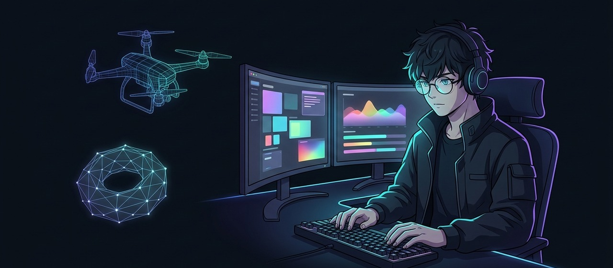
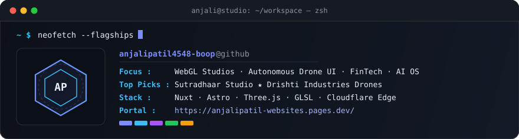
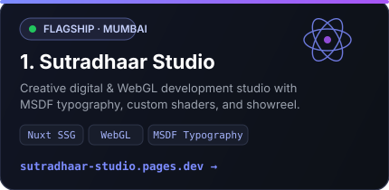
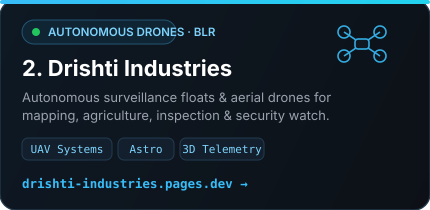
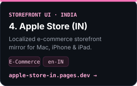
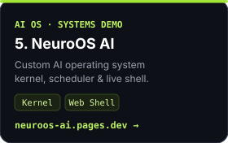

  
    
  <picture>
    <source media="(prefers-color-scheme: dark)" srcset="./assets/ascii-banner-dark.svg" />
    <source media="(prefers-color-scheme: light)" srcset="./assets/ascii-banner.svg" />
    
  </picture>

 

<table>
  <tr>
    <td width="165" align="center" valign="middle">
      
       
      <strong>Anjali Patil</strong> · India
    </td>
    <td valign="middle">
      
    </td>
  </tr>
</table>

---

## Featured Flagships (Top Picks)

<table>
  <tr>
    <td width="50%" align="center">
      
       
      <a href="https://sutradhaar-studio.pages.dev/">Live Website</a> ·
      <a href="https://github.com/anjalipatil4548-boop/sutradhaar-studio">Repository</a>
    </td>
    <td width="50%" align="center">
      
       
      <a href="https://drishti-industries.pages.dev/">Live Website</a> ·
      <a href="https://github.com/anjalipatil4548-boop/drishti-industries">Repository</a>
    </td>
  </tr>
</table>

---

## Highlighted Product Launches

<table>
  <tr>
    <td width="33%" align="center">
      
       
      <a href="https://kosha-payments.pages.dev/">Live</a> ·
      <a href="https://github.com/anjalipatil4548-boop/kosha-payments">Repo</a>
    </td>
    <td width="33%" align="center">
      
       
      <a href="https://apple-store-in.pages.dev/in/store">Live</a> ·
      <a href="https://github.com/anjalipatil4548-boop/apple-store-in">Repo</a>
    </td>
    <td width="33%" align="center">
      
       
      <a href="https://neuroos-ai.pages.dev/">Live</a> ·
      <a href="https://github.com/anjalipatil4548-boop/neuroos-ai">Repo</a>
    </td>
  </tr>
</table>

---

## Live Telemetry & Contribution Activity

<table>
  <tr>
    <td width="40%" align="center" valign="middle">
      <a href="https://drishti-industries.pages.dev/">
        <picture>
          <source media="(prefers-color-scheme: dark)" srcset="./assets/ascii-radar-dark.svg" />
          <source media="(prefers-color-scheme: light)" srcset="./assets/ascii-radar.svg" />
          
        </picture>
      </a>
       
      Animated ASCII Radar Telemetry powered by <a href="https://ascii.rest/">ascii.rest</a>
    </td>
    <td width="60%" align="center" valign="middle">
      <picture>
        <source media="(prefers-color-scheme: dark)" srcset="https://raw.githubusercontent.com/anjalipatil4548-boop/anjalipatil4548-boop/output/github-contribution-grid-snake-dark.svg" />
        <source media="(prefers-color-scheme: light)" srcset="https://raw.githubusercontent.com/anjalipatil4548-boop/anjalipatil4548-boop/output/github-contribution-grid-snake.svg" />
        
      </picture>
        
      
      
      
      
      
        
      
    </td>
  </tr>
</table>
